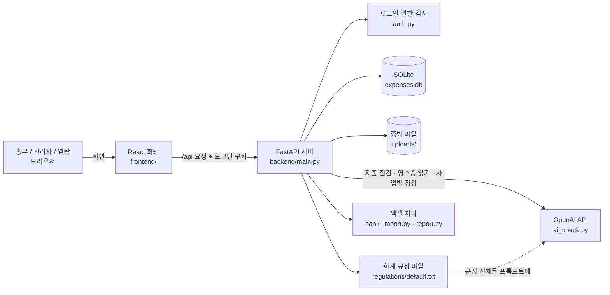

# 짝장부 (학생회 회계 도우미)

학생회 총무가 평소 하는 회계 일(지출 기록, 증빙 정리, 예산 확인, 결산)을 덜어 주는 서비스입니다.
AI는 동료처럼 회계 규정을 근거로 "챙길 것"을 알려 주고, 최종 결정은 총무가 합니다. (2026 AI 우왕톤, 주제: "AI는 동료가 될 수 있을까?")

## 주요 기능

**지출 기록**
- 지출 등록: 지출 항목(비목)은 감사 공식 양식의 9개(수용비, 식비, 활동비, 상품비, 대여비, 수당, 보조비, 교통비, 환급비). 직접 입력하거나, 영수증 사진을 올리면 AI가 날짜·금액·내용을 읽고 사업명·지출 항목까지 추천해 채움 (총무가 확인 후 저장)
- AI 점검: 저장할 때 규정 파일을 근거로 점검해 문제 없음 / 확인 필요 / 조치 필요, 근거 조항, 이유, 챙길 것(할 일 목록)을 알려 줌
  - AI가 실패해도(장애·잔액 부족) 지출은 '점검 못 함'으로 저장되고, 그런 지출만 한 번 더 점검할 수 있음
- 총무 결정: 확정·취소. 확인·조치 필요 지출은 메모를 남겨야 확정. 모든 결정은 기록으로 남음
- 지출 상세: 수정·삭제(삭제는 표시만), 메모, 증빙 파일(사진·PDF) 첨부
- 서류 만들기: 사필영수증(지불자·수령자 명단 포함)과 도안 출장 요청서를 대의원회 공식 양식의 항목·순서대로, 지출 정보를 미리 채워 인쇄
- 거래내역 불러오기: 카카오뱅크·토스뱅크 엑셀(비밀번호 파일 포함)의 출금을 등록된 지출과 맞춰 보고, 빠진 출금은 바로 등록
- 감사 자가 점검: 감사 채점표 항목(공약 및 사업, 예·결산보고서, 영수증, 도안, 회계장부, 감사 태도)별로 감점될 수 있는 것(예산 초과, 증빙 없음, 활동비 한도·잔액, 통장 대조 등)과 실제 감점 사례를 모아 보여 줌
  - 사업별 AI 점검: 사업 하나를 골라 [AI 점검]을 누르면 AI가 그 사업의 기록을 실제 감점 사례와 비교해 감사 전에 챙길 것을 정리 (예산만 있고 지출 전인 사업도 가능, 누를 때만 1번 호출, 결과 저장)

**예산·일정**
- 대시보드: 통장 잔액, 최근 입출금, 예산 사용률, 챙길 것, 결정 기다리는 지출, 다가오는 일정, 사업별·월별 지출
- 예산·결산: 임기별 4개 기간(학기 전/1학기/여름방학/2학기) 예산 대비 지출, 사업 묶기(예: MT 사전답사 → MT), 결산보고서 엑셀(대의원회 공식 양식에 표지·기안서·결산서를 채워 줌)
- 캘린더: 지출과 일정(여러 날 일정 가능)을 날짜별로 보고, 그 사업의 지출로 바로 이동

**인수인계·관리**
- 임기(연도)별 구분, 새 임기 만들기(지난 예산 구조 복사), 지난 학생회 자료 열람
- 역할: 관리자 / 총무 / 열람(보기만). 관리자 권한 넘기기, 모든 변경 기록 보기
- 내 정보: 이름·직책·비밀번호 변경, 내 활동 요약, 로그인된 기기 확인과 다른 기기 로그아웃, 내 최근 활동
- 사용량·백업(관리자): 달별 AI 사용량, 전체 데이터 백업 zip 내려받기

## 심사·체험 방법
- 배포 주소와 테스트 계정(총무 역할)은 최종 제출 폼에 적었습니다. 계정 정보는 공개 저장소에 올리지 않습니다.
- 시연용 데이터는 가상 샘플입니다 (아래 '임시 데이터 안내'). AI 점검 결과는 샘플을 넣을 때 실제 OpenAI 호출로 만든 것입니다.
- 추천 순서
  1. 대시보드: 통장 잔액, 챙길 것, 결정 기다리는 지출
  2. 지출 등록: 직접 입력하거나 영수증 사진으로 채우기 → 저장하면 AI 점검 → 상세 화면에서 근거 조항·챙길 것 확인
  3. 지출 목록: 확인 필요 지출에 메모를 남기고 확정
  4. 감사 자가 점검: 채점표 항목별 감점 위험, 사업 하나를 골라 [AI 점검]
  5. 예산·결산: 예산 대비 지출, 결산보고서 엑셀 내려받기 / 지출 상세의 서류 만들기(사필영수증)
- 지출 등록, 영수증 읽기, 사업별 AI 점검은 누를 때마다 OpenAI를 1번 부릅니다.

## 아키텍처



- 배포: Railway 한 서비스에서 `backend/serve.py`가 React 빌드 결과와 API(`/api/...`)를 함께 내보냅니다. DB와 증빙 파일은 볼륨(`/data`)에 저장됩니다.
- AI가 하는 일과 사람이 하는 일
  1. 총무가 지출을 등록하면 서버가 규정 파일 전체와 지출 정보를 OpenAI에 보내고, JSON(결과·근거 조항·이유·챙길 것)을 받아 저장합니다.
  2. 화면에는 AI 결과를 '동료의 의견'으로 보여 주고, 확정은 총무가 합니다 (확인·조치 필요는 메모를 남겨야 확정).
  3. 모든 결정과 수정은 기록(누가, 언제)으로 남습니다.

## 기술 선택 이유 (ADR)

| 결정 | 이유 | 대안과 버린 이유 |
|---|---|---|
| 규정 전체를 프롬프트에 넣음 (벡터 DB 없음) | 규정 파일이 약 1만 자로 짧아 통째로 넣어도 되고, 근거 조항을 빠뜨리지 않음. 앞부분이 같아 프롬프트 캐시로 비용도 줄어듦 | RAG(벡터 검색): 짧은 문서에선 검색이 조항을 놓칠 위험만 커짐 |
| 규정은 코드가 아닌 텍스트 파일 | 실제 규정을 받으면 파일만 바꾸면 되고, 다음 학생회도 코드 없이 고칠 수 있음 | 코드에 규칙을 직접 작성: 규정이 바뀔 때마다 개발자가 필요 |
| AI 결과는 JSON 형식만 받기 | 화면에 결과·근거·할 일을 나눠 보여 주고 저장하기 위해. 형식이 틀리면 '점검 못 함'으로 저장 | 자유 문장: 화면 표시와 필터가 불가능 |
| AI 호출은 3곳, 버튼을 누를 때만 | 학생회 예산으로 쓰는 서비스라 비용이 중요. 이미 점검한 지출의 재점검은 두지 않음 | 일괄 재점검·자동 점검: 비용이 지출 수에 비례해 늘어남 |
| AI는 판단만, 확정은 사람 | 대회 주제 "AI는 동료가 될 수 있을까". 감사 책임은 총무에게 있음 | AI 자동 확정: 잘못된 판단이 그대로 장부에 남음 |
| SQLite | 학생회 한 곳의 데이터 양이 작고, 파일 하나라 백업·인수인계가 쉬움 | PostgreSQL 등: 이 규모에선 운영 부담만 큼 (데이터에 org_id를 두어 확장 여지는 남김) |
| 쿠키 세션 로그인 + 서버 권한 검사 | 비밀번호는 scrypt 해시로만 저장, 권한(관리자/총무/열람)은 서버 미들웨어에서 막음 | 화면에서만 숨기기: 주소를 직접 부르면 뚫림 |
| 삭제는 표시만, 기록은 지우지 않음 | 감사 대비. 무엇을 언제 누가 바꿨는지 남아야 함 | 실제 삭제: 감사 때 설명할 근거가 사라짐 |
| 결산보고서는 공식 엑셀 양식에 채움 | 대의원회가 받는 양식 그대로 내야 해서, 공식 파일을 열어 값만 넣음 (수식은 양식 그대로) | 새 엑셀 생성: 양식이 달라 다시 옮겨 적어야 함 |
| 화면과 API를 한 서버로 배포 | 서버 하나라 비용·설정이 단순하고, 같은 주소라 쿠키·CORS 문제가 없음 | 프론트·백엔드 따로 배포: 주소 2개, CORS·쿠키 설정 필요 |

## AI 비용을 아끼는 방식
OpenAI 호출은 실제 비용이 들어서, 호출은 세 곳뿐입니다: 지출을 저장할 때 점검 1번, 영수증 읽기 버튼을 눌렀을 때 1번, 감사 자가 점검의 사업별 [AI 점검]을 눌렀을 때 1번 (결과를 저장해 다시 열 때는 부르지 않음). 1번에 약 3,500~4,500토큰입니다.
이미 점검된 지출을 다시 점검하는 기능은 두지 않았습니다 (수정한 지출은 "수정 전 내용 기준" 안내를 보여 줌).
한 달 사용 횟수가 `backend/.env`의 `AI_MONTHLY_WARN`(기본 300회)을 넘으면 경고를 띄웁니다. 막지는 않으며, 관리자는 '사용량·백업' 화면에서 사용량을 봅니다.

## 백업과 되살리기
관리자 '사용량·백업' 화면에서 [백업 내려받기]를 누르면 DB(`expenses.db`)와 증빙 파일(`uploads/`)이 zip 하나로 받아집니다.
되살릴 때는 백엔드를 끄고 `backend/expenses.db`와 `backend/uploads/`를 zip 안의 것으로 바꾼 뒤 다시 켭니다. 개인정보가 들어 있으니 GitHub 등에 올리지 마세요.

## 추후 개발
- 휴대폰 화면 정리, 회원가입(구글 계정 연동 + 일반 아이디 가입)은 이번 대회 MVP 이후에 진행합니다.

## 임시 데이터 안내
- 회계 규정: `backend/regulations/default.txt`의 제1부는 **실제 충북대학교 총학생회칙**(2024.9.20 시행)의 재정 조항 원문입니다. 제2부(감사지침)는 과 학생회를 감사하는 전자정보대학 대의원회 홈페이지의 안내, 2025~2026년 실제 감사 결과의 감점 사유, 총대의원회의 「감사시행세칙」·「2026 총무소양교육자료」 중 지출 점검에 필요한 부분을 정리한 것입니다. 양식 파일 중 이름에 '(학과)'가 붙은 것이 전자정보대학 대의원회 양식입니다. 원본 규정·양식 파일은 `docs/raw/`에 있습니다.
- 지출 데이터: `backend/sample_data/expenses.json`은 **가상으로 만든 샘플 지출**입니다. 점검 결과는 미리 정해두지 않고, 넣을 때 실제 OpenAI 호출로 만들어집니다.
- 예산·일정: `backend/sample_data/demo_data.json`은 **가상으로 만든 시연용 예산과 일정**입니다.
- 거래내역: `backend/sample_data/kakaobank_sample.xlsx`, `tossbank_sample.xlsx`는 실제 카카오뱅크·토스뱅크 거래내역 파일을 바탕으로, **같은 양식에 내용만 가상으로 채운 거래내역**입니다.

## 데이터·오픈소스 출처

**사용한 데이터** (원본 파일은 `docs/raw/`)

| 자료 | 출처 | 어디에, 어떻게 썼는지 |
|---|---|---|
| 충북대학교 총학생회칙 (2024.9.20 시행) | 충북대학교 총학생회 | 규정 파일 제1부: 재정 조항 원문 발췌 (AI 점검 근거) |
| 감사시행세칙, 2026 총무소양교육자료, 서류 양식 | 충북대학교 총대의원회 | 규정 파일 제2부(비목·증빙·도안 기준, 감사 채점표·등급) 요약 정리 |
| 감사 방식·비목·서류 작성 방법·Q&A 안내, 서류 양식('(학과)' 파일) | 충북대학교 전자정보대학 제25대 결 대의원회 홈페이지 | 규정 파일 제2부 요약 정리, 결산보고서 엑셀 양식(그대로 열어 값만 채움), 사필영수증·도안 출장 요청서 화면의 항목·순서 |
| 2025~2026 감사 결과 공고 (감점 사유) | 전자정보대학 제24대 백야·제25대 결 대의원회 공개 게시물 | 자주 나온 감점 사유만 일반화해 규정 제2부와 감사 자가 점검 화면의 '실제 감점 사례'에 사용 (학과별 점수는 쓰지 않음) |
| 카카오뱅크·토스뱅크 거래내역 엑셀 양식 | 각 은행 앱의 거래내역 내보내기 | 엑셀 읽기 형식에 맞춤. 샘플 파일은 같은 양식에 가상 내용을 채운 것 |
| 샘플 지출·예산·일정 | 팀이 직접 만든 가상 데이터 | 시연용 (`backend/sample_data/`) |

**사용한 AI 서비스**
- OpenAI API (Chat Completions, 모델은 `OPENAI_MODEL`, 기본 `gpt-5.4-mini`): 지출 점검, 영수증 사진 읽기, 사업별 감사 전 점검. 점검 결과는 미리 정해 두지 않고 매번 실제 호출 결과를 사용합니다.

**사용한 오픈소스**

| 이름 | 쓰임 | 라이선스 |
|---|---|---|
| React, React DOM | 화면 | MIT |
| React Router | 페이지 이동 | MIT |
| Vite, @vitejs/plugin-react | 화면 개발 서버·빌드 | MIT |
| Pretendard | 글꼴 | SIL OFL 1.1 |
| oxlint | 코드 검사 | MIT |
| FastAPI | API 서버 | MIT |
| Uvicorn | 서버 실행 | BSD-3-Clause |
| openai (Python) | OpenAI 호출 | Apache-2.0 |
| python-dotenv | `.env` 읽기 | BSD-3-Clause |
| python-multipart | 파일 업로드 | Apache-2.0 |
| openpyxl | 엑셀 읽기·쓰기 | MIT |
| msoffcrypto-tool | 비밀번호 걸린 엑셀 풀기 | MIT |
| SQLite | 데이터베이스 | Public Domain |

## 개발 진행 (MVP)
- [x] 지출 등록 → AI 점검 → 결과 표시 → 총무 결정
- [x] 실제 OpenAI 키로 점검 결과 확인

## 실행 방법

먼저 API 키를 설정합니다. `backend/.env.example`을 복사해 `backend/.env`로 만들고 OpenAI API 키를 넣으세요.
```bash
cp backend/.env.example backend/.env
```

터미널 2개를 열어 각각 실행합니다.

백엔드 (http://localhost:8000)
```bash
cd backend
pip install -r requirements.txt
uvicorn main:app --reload
```

프론트엔드 (http://localhost:5173)
```bash
cd frontend
npm ci
npm run dev
```

처음 한 번, 첫 관리자 계정을 만듭니다 (백엔드 폴더에서). 다른 계정은 로그인 후 '사용자 관리'에서 만듭니다.
```bash
python create_admin.py
```

시연용 가상 데이터(예산, 일정, 거래내역, 지출)를 넣으려면 (백엔드 폴더에서)
여러 번 실행해도 이미 들어간 데이터는 건너뜁니다. 지출 38건은 실제 AI 점검을 거치므로 토큰이 듭니다 (새로 넣는 건만, 1건에 약 3,500토큰).
10월 이전 지출 중 AI가 '문제 없음'으로 본 것은 넣을 때 확정해 둡니다 (쓰던 장부처럼 보이게).
```bash
python sample_data/load_samples.py
```

AI 호출 없이 예산·일정·거래내역만 넣으려면
```bash
python sample_data/load_samples.py --no-ai
```

(`npm ci`는 `package-lock.json`에 적힌 버전 그대로 설치합니다. 백엔드도 `requirements.txt`에 버전이 고정되어 있습니다. Python 3.13에서 확인했습니다.)

브라우저에서 http://localhost:5173 을 열면 됩니다.
지출 데이터는 backend/expenses.db 파일에, 증빙 파일은 backend/uploads/에 저장됩니다. (GitHub에는 올라가지 않음. 환경변수 `DATA_DIR`로 저장 폴더를 바꿀 수 있음)

## 배포 (Railway)
화면과 API를 한 서버에서 함께 내보냅니다 (`Dockerfile`, `backend/serve.py`). 화면은 같은 주소의 `/api`로 API를 부릅니다.

1. Railway에서 New Project → Deploy from GitHub repo → 이 저장소 선택 (루트의 `Dockerfile`로 자동 빌드)
2. 프로젝트 화면(바탕)에서 + Create → Volume으로 볼륨을 만들어 이 서비스에 연결하고 Mount path를 `/data`로 지정 (DB와 증빙 파일이 여기에 저장되어 재배포해도 남음)
3. Variables에 추가
   - `OPENAI_API_KEY`: OpenAI API 키
   - `OPENAI_MODEL`: (선택) 사용할 모델
   - `AI_MONTHLY_WARN`: (선택) 한 달 AI 사용 경고 기준, 기본 300
   - `DATA_DIR=/data`, `COOKIE_SECURE=1`은 Dockerfile에 이미 들어 있음
   - 볼륨·변수를 바꾸면 서비스에 'Edited · n Changes'가 뜹니다. **Deploy를 눌러 적용해야** 실제로 반영됩니다.
4. Settings → Networking → Generate Domain 으로 접속 주소 만들기
5. 첫 관리자 만들기: Railway CLI(`npm install -g @railway/cli` → `railway login` → `railway link`)로 서버에 접속해 실행. SSH 키가 없다고 나오면 `ssh-keygen -t ed25519`로 만든 뒤 다시 접속합니다.
   ```bash
   railway ssh
   ```
   ```bash
   df -h /data
   ```
   (`Mounted on`이 `/data`로 나와야 볼륨이 붙은 것입니다.)
   ```bash
   python create_admin.py
   ```
6. (선택) 시연용 데이터: 같은 접속 화면에서 `python sample_data/load_samples.py` (AI 없이 넣으려면 `--no-ai`)
   - ssh 화면에 API 키가 없으면(`echo $OPENAI_API_KEY | cut -c1-3`이 비어 있음) `read -s OPENAI_API_KEY && export OPENAI_API_KEY`로 키를 넣은 뒤 실행합니다. 키 없이 넣은 지출은 '점검 못 함'이 되며, 키를 넣고 다시 실행하면 그 지출만 다시 점검합니다.
